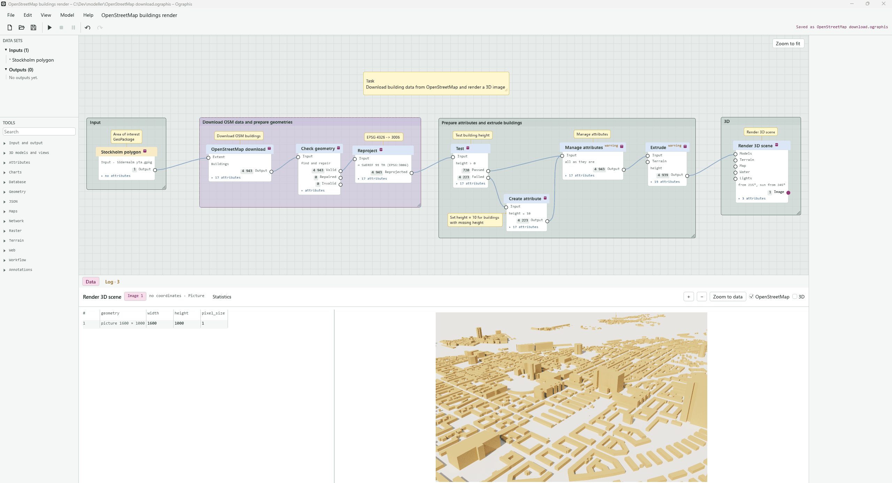

# Ographis

Spatial ETL for the desktop, written in Rust. A graphical program where you connect
inputs, tools and outputs on a canvas, and a command line that runs the same
models. No web technology, no cloud, and no licence fee: MIT or Apache 2.0.

```
ographis examples/skaraborg.ographis          the graphical program
og run examples/skaraborg.ographis            the same model from the command line
```



> **A preview.** Ographis is young and changes between versions. Models are kept working
> as the program changes, but check the results before you rely on them, and tell us what
> breaks in an [issue](https://github.com/gishubio/Ographis/issues).
>
> Ographis is a hobby project, kept up in spare time by one person. Issues and pull requests
> are welcome and read, but an answer may take a while.
>
> Ographis is written by Claude, guided by human GIS expertise. It is not:
>
> - feature complete
> - polished
> - well tested
> - well documented
>
> Ographis is provided "as is". Run and use Ographis at your own risk.

## What it does

- **Reads and writes** GeoPackage, Shapefile, GeoJSON, FlatGeobuf, GeoParquet, CSV, Excel,
  LibreOffice Calc, DXF, GeoTIFF, CityGML, CityJSON, IFC, OBJ, glTF and 3D Tiles, PostGIS
  and SQL Server, files on the web, WFS, OGC API Features, ArcGIS FeatureServer, STAC,
  OpenStreetMap and vector tiles (MBTiles, PMTiles). The whole list is in [docs/FORMATS.html](docs/FORMATS.html).
- **Over a hundred tools** for attributes, geometry, joins by attribute and by location,
  overlays, rasters and terrain, web APIs with paging, keys and OAuth2, charts, maps and
  3D scenes, terrain and point clouds, and toy landscapes ("dioramas") made from land cover. See
  [docs/TOOLS.md](docs/TOOLS.md).
- **Outputs** to files and databases, maps and charts as pictures, PDF with layers,
  interactive HTML charts, and PowerPoint and Impress slides.
- **A canvas** where you see the data of each step in a table, on a map and in 3D as the
  model runs, with undo, groups, comments and a recovery of unsaved work.
- **The command line** `og` runs the same models on a schedule, with variables, a history
  of runs and exit codes. See [docs/GUIDE.md](docs/GUIDE.md).
- **For AI assistants**: a reference of every tool as JSON, a schema of the model format and
  `og check`, which tells an assistant what is wrong in a model it wrote. See
  [AGENTS.md](AGENTS.md).

Passwords and API keys are kept in the Windows Credential Manager, not in the model or the
settings file.

## Getting started

On Windows 11, once Rust and GDAL (OSGeo4W) are installed, the program is built and started
like this. The steps are in [docs/BUILD-WINDOWS.md](docs/BUILD-WINDOWS.md).

```
.\build.cmd
.\Ographis.cmd examples\skaraborg.ographis
```

`.\build.cmd -Package` also makes a folder and a zip file in `dist` that runs on a computer
without OSGeo4W. On Linux, `cargo build --release` with GDAL 3.4 or later installed (see `CONTRIBUTING.md`).

Open one of the [examples](docs/EXAMPLES.md), press F5 to run it, and click a node to see
what came out of it.

Ographis was called GeoBobbo up to version 0.74. Models saved as `.json` by GeoBobbo open and
run as they did, and its settings are taken over the first time Ographis starts.

## What is here

| Part | Contents |
| --- | --- |
| `crates/og-engine` | Data model, expression language, node types, model format, execution and the history of runs. CSV and txt, GeoParquet, CityGML and CityJSON, IFC with its advanced breps, OBJ and glTF. No GDAL. |
| `crates/og-gdal` | GeoPackage, Shapefile, GeoJSON, FlatGeobuf, SpatiaLite, DXF, Excel, LibreOffice Calc and GeoTIFF, styled workbooks, files from the web, and reprojection between coordinate systems, through GDAL and PROJ. |
| `crates/og-cli` | The command line `og`. |
| `crates/og-gui` | The graphical program `ographis`, built with egui and egui-snarl. No web technology. |
| `vendor/egui-snarl` | The node canvas library, with a small patch. See `vendor/egui-snarl/OGRAPHIS.md`. |
| `examples/` | Example data and 44 models, also for web APIs in `apis/`; `formats/` holds a CAD drawing, GeoParquet, a city model and vector tiles. `house/` holds the example house, which Ographis made itself, as OBJ and as glTF, and `tiles/` three of it as 3D Tiles. |
| `build.cmd`, `build.ps1` | Builds on Windows 11: finds GDAL, builds, writes launchers and runs the build test. With `-Package`, also a folder and a zip file in `dist` that runs on a computer without OSGeo4W, to give to others. |
| `docs/GUIDE.md` | The graphical program, the command line and what to do when something goes wrong. |
| `docs/TOOLS.md` | Every input, tool and output, and the model format. |
| `docs/EXAMPLES.md` | The example models and the web APIs they talk to. |
| `docs/DESIGN.md` | The choices that were made, and the known limitations. |
| `docs/TESTING.md` | What the tests cover. |
| `docs/BUILD-WINDOWS.md` | Step by step on Windows 11, and what has been checked. |
| `docs/FORMATS.html` | The formats Ographis reads and writes, and whether GDAL or Ographis itself handles each, as written by `og formats --html`. |
| `CHANGELOG.md` | What changed in each version. |
| `AGENTS.md`, `docs/nodes.json`, `docs/model.schema.json` | For AI assistants that write models: how, the reference of every node type, and a JSON Schema of the model format. |
| `ARCHITECTURE.md`, `CONTRIBUTING.md` | How the code hangs together, and how to build, test and add a tool. |
| `.github/` | Templates for issues and pull requests, and a check that builds and tests on Linux. |
| `LICENSE-MIT`, `LICENSE-APACHE` | Ographis's licence: MIT or Apache 2.0, as you choose. |
| `THIRD-PARTY-LICENSES.md`, `tools/third_party.py` | The libraries and the font Ographis is built with, and their licences. The script writes the file again when the dependencies change. |

## Licence

Ographis is licensed under either of the MIT licence (`LICENSE-MIT`) or the Apache License 2.0
(`LICENSE-APACHE`), at your option, as most of the Rust libraries it is built with. Unless
you say otherwise, a contribution you send in is licensed in the same way. The libraries,
the Inter font and GDAL keep their own licences: see `THIRD-PARTY-LICENSES.md`.
